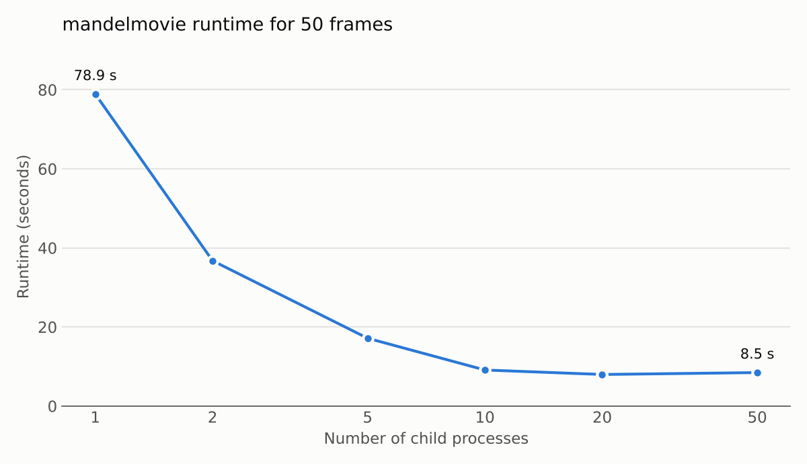

# Lab 11 – Multiprocessing

**Name:** Jim Luzano-Belfield
**Course:** CPE-2600 Systems Programming, Section <SECTION>
**Assignment:** Lab 11 – Multiprocessing

## Overview

`mandelmovie` generates the frames of a movie that zooms into the Mandelbrot set. It does not compute any pixels itself. For every frame it forks a child process, and the child uses `execl` to replace itself with the provided `mandel` program, passing it the center point, scale, image size, iteration limit, and an output file name (`mandel0.jpg` … `mandel49.jpg`).

The number of children that may run at the same time is set with `-p`. The parent keeps a count of running children. Before forking a new one, if the count has reached the limit, the parent calls `wait()` to block until any child finishes, then starts the next frame in its place. After the last frame has been started, the parent waits for every remaining child before it exits. Each child is independent once forked, so no pipes or shared memory are needed.

The zoom is geometric: each frame's scale is the previous one multiplied by a constant factor, so the movie flies in at a steady visual speed from a scale of 4 (the whole set) down to 0.00005. The default target is Seahorse Valley, at (-0.7436438870371587, 0.13182590420531198).

### Changes to the provided `mandel` program

- `iteration_to_color()` now uses a smooth cosine color palette instead of gray, and points inside the set are drawn black.
- The `getopt` return value is stored in an `int` instead of a `char`. With a `char`, the `-1` end-of-options value can be misread on platforms where `char` is unsigned.
- The help text lists the correct default output file (`mandel.jpg`).

## Building and running

```bash
sudo apt install libjpeg-dev ffmpeg
make                       # builds mandel and mandelmovie
./mandelmovie -p 5         # 50 frames using up to 5 child processes
make movie                 # stitches mandel0.jpg..mandel49.jpg into mandel.mpg
```

### `mandelmovie` options

| Option | Meaning | Default |
|---|---|---|
| `-p <procs>` | Child processes running at once | 1 |
| `-n <frames>` | Number of frames | 50 |
| `-x <coord>` | X coordinate of zoom target | -0.7436438870 |
| `-y <coord>` | Y coordinate of zoom target | 0.1318259042 |
| `-s <scale>` | Starting scale | 4 |
| `-e <scale>` | Ending scale | 0.00005 |
| `-W <pixels>` | Width and height of each frame | 800 |
| `-m <max>` | Max iterations per point | 1000 |
| `-h` | Help | |

Any process count from 1 up to the number of frames works. A larger value is reduced to the number of frames.

The movie is played at 10 frames per second, so 50 frames make a 5-second movie (`mandel.mpg` in this repo).

## Runtime results

Runtimes were measured with bash's `time` (wall-clock seconds) using `run_timing.sh`, which runs `mandelmovie` once for each process count and saves the results to `timing.csv`. `plot_timing.py` draws the graph from that file.

| Child processes | Runtime (s) |
|---|---|
| 1 | 59.7 |
| 2 | 30.6 |
| 5 | 30.0 |
| 10 | 30.2 |
| 20 | 30.0 |
| 50 | 30.2 |



## Discussion

Going from 1 to 2 processes almost exactly halved the runtime, from 59.7 s to 30.6 s. After that, adding more processes made no difference: 5, 10, 20, and even 50 processes all finished in about 30 seconds.

The machine these timings were taken on has 2 CPU cores, which explains the shape of the graph. Rendering a frame is purely CPU-bound work with almost no file or network waiting, so each running child keeps one core fully busy. With 2 children, both cores are working all the time, and the work is done in half the time. With more than 2 children, the extra processes have no free core to run on. The operating system just takes turns running them on the same 2 cores, so the total amount of work per core stays the same and the runtime stays flat.

So using more processes does **not** always speed things up. The speedup stops once the number of processes reaches the number of cores. Past that point, extra processes cost a little more in context switching and memory but gain nothing, which is why the 10 and 50 process runs were very slightly slower than the 5 process run. Fork and exec overhead is small compared with the hundreds of milliseconds each frame takes to render, so it does not show up in these numbers.

One more detail affects how well the work spreads out. Frames are not equal in cost: the deeper frames near the end of the zoom contain more of the detailed boundary of the set, so they need more iterations per pixel and take longer. Because the parent hands out a new frame as soon as any child finishes, a core that finished a cheap frame immediately picks up the next one. This keeps both cores busy and is why the 2-process run came so close to a perfect 2× speedup.

On a machine with more cores, the curve would keep dropping until the process count reached the core count, then flatten out in the same way.
